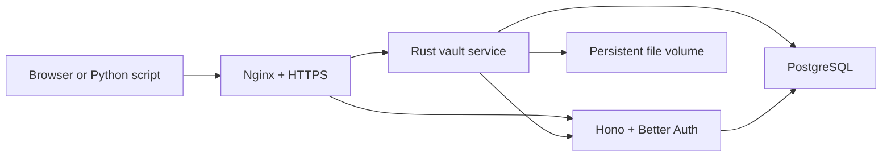

# Clipboard Vault

A lightweight, self-hosted team vault for pasted text and arbitrary files.

The main application is a Rust/Axum server. A small Hono service runs Better Auth for
password and optional Google, GitHub, or Discord login, account approvals, workspaces, and API keys. PostgreSQL
stores searchable metadata; file bytes stay on a persistent VPS volume.

## What it does

- Manual paste composer with text, code, HTML, and URL detection.
- Resumable, streamed file uploads up to 10 GiB without loading the whole file into memory.
- Inline previews for text, code, safe HTML/Markdown, images, and ranged PDFs.
- Private workspaces with owner, admin, and member roles.
- Global approval queue for every new account.
- Password login plus optional Google, GitHub, and Discord login through Better Auth.
- Workspace API keys with read, write, and delete permissions.
- Ready-to-run Python multipart and resumable file uploaders.
- Trash, restore, search, tags, exports, and activity records.
- Docker Compose, Nginx, Certbot, health checks, and GitHub Actions.

Clipboard Vault never reads or monitors the browser clipboard on its own. It sees clipboard
data in exactly two moments the user initiates: pressing Ctrl+V (or Cmd+V) on the vault page,
which saves the pasted image or puts pasted text into the capture box, and clicking a Copy
button, which writes to the clipboard.

## Architecture



Only Nginx exposes ports 80 and 443. The Rust, authentication, and database services
communicate through a private Docker network.

## Quick start

Requirements:

- Docker Engine 25 or newer with Docker Compose 2.20.2 or newer.
- A domain name for production social login and HTTPS.
- A client ID and secret for each social provider you enable.

```bash
cp .env.example .env
# Edit .env and replace every placeholder.
docker compose up --build
```

For password-only local testing, set `DOMAIN=localhost` and
`PUBLIC_BASE_URL=http://localhost` in `.env`, then open `http://localhost`. The first registered user
must visit `/setup` and enter `BOOTSTRAP_TOKEN`. After that succeeds, the setup
route refuses all future claims.

Generate independent secrets with:

```bash
openssl rand -hex 32
```

Run that command separately for `POSTGRES_PASSWORD`, `BETTER_AUTH_SECRET`,
`AUTH_BRIDGE_SECRET`, and `BOOTSTRAP_TOKEN`. Never commit the resulting
`.env` file. Hex output is intentional: it is safe inside the PostgreSQL connection URL.

For a real VPS, follow [DEPLOYMENT.md](DEPLOYMENT.md).

## Social authentication

Social providers are enabled only when both variables in their credential pair are set. A
partial pair fails startup with the missing variable named in the error; no credentials are
ever returned by the provider-discovery endpoint.

Register these exact production callbacks in the relevant provider console:

```text
https://vault.your-domain.com/api/auth/callback/google
https://vault.your-domain.com/api/auth/callback/github
https://vault.your-domain.com/api/auth/callback/discord
```

Set one or more complete pairs in the private VPS `.env`:

```dotenv
GOOGLE_CLIENT_ID=...
GOOGLE_CLIENT_SECRET=...
GITHUB_CLIENT_ID=...
GITHUB_CLIENT_SECRET=...
DISCORD_CLIENT_ID=...
DISCORD_CLIENT_SECRET=...
PUBLIC_BASE_URL=https://vault.your-domain.com
DOMAIN=vault.your-domain.com
```

For Google, create a Web application OAuth client. For GitHub OAuth Apps, request
`user:email`; GitHub Apps additionally need read-only Email addresses permission. Discord
uses only `identify` and `email`, with no bot or guild permissions.

Better Auth links a social identity to an existing user only when the provider verifies the
same email address. Different-email linking, forced trusted-provider linking, profile
overwrites during linking, and unlinking the last identity are disabled. A provider account
without a verified email is rejected rather than assigned a placeholder address.

To add another built-in Better Auth provider, extend the typed registry in
`auth/src/providers.ts`, add its credential pair, tests, callback documentation, and release
it normally. The login page does not need provider-specific browser logic.

For example, in Google Cloud Console:

1. Create or select a project.
2. Open APIs & Services, then Credentials.
3. Create an OAuth client ID with application type Web application.
4. Add this exact authorized redirect URI:

```text
https://vault.your-domain.com/api/auth/callback/google
```

5. Put the client ID and secret into the private VPS `.env`.

The URL scheme, hostname, path, and trailing slash must match exactly. Production callbacks
require HTTPS and normally cannot use a raw VPS IP address.

## Accounts and workspaces

- Registration creates a pending account and a session with no vault access.
- A global admin approves or rejects the account.
- Approval creates the user’s personal workspace.
- Workspace owners and admins create private invitation links.
- Owners control limits, members, ownership transfer, and deletion; admins control limits,
  non-owner members, items, and all workspace keys.
- Invited users still need global approval.
- Invitation links are stored as hashes, work once, and expire after 48 hours.
- No email service runs. A global admin can create a one-time password-reset link and send
  it to the user manually.

Global administrators manage the server from **Administration**:

- Open or close registration. When closed, `/sign-up/email` and first-time social sign-ins
  are refused, and only administrators create accounts.
- Require approval for new accounts, or let them open their workspace immediately.
- Set the default per-file upload limit (10 GiB unless lowered; capped by
  `SERVER_MAX_UPLOAD_BYTES`). Workspace owners can still choose their own limit.
- Create approved accounts with a password, grant or remove the administrator role, disable
  and re-enable accounts, sign an account out everywhere, issue reset links, and delete an
  account together with the workspaces only it owns.

The first admin is protected by the private `BOOTSTRAP_TOKEN`. Choose a random value,
register the intended account, visit `/setup`, and claim the instance before sharing
the site.

## API keys

Open Keys & team inside a workspace. Create a named key, choose its expiration and optional
permissions, then copy it immediately. The complete key is shown once.

The key decides the workspace. Scripts cannot submit another workspace ID.

### Paste text

```bash
curl -X POST "https://vault.example.com/api/v1/items" \
  -H "Authorization: Bearer cv_live_REPLACE_ME" \
  -H "Content-Type: application/json" \
  -d '{
    "payload": "fn main() { println!(\"hello\"); }",
    "type": "auto",
    "virtual_path": "/snippets/rust",
    "tags": ["rust", "example"]
  }'
```

### Upload a file

```bash
curl -X POST "https://vault.example.com/api/v1/items" \
  -H "X-API-Key: cv_live_REPLACE_ME" \
  -F "file=@./report.pdf" \
  -F "virtual_path=/reports/2026" \
  -F 'tags=["report","monthly"]'
```

Both `Authorization: Bearer` and `X-API-Key` are supported.

The multipart endpoint is retained for compatibility and accepts files up to 100 MiB.
Larger files use the Tus 1.0 endpoint. The browser uploads in 16 MiB chunks and can pause,
retry, or resume from the last server-confirmed offset after an interruption. Tus upload
sessions expire after seven idle days.

The deployment ceiling is 10 GiB per file. A workspace starts at 100 MiB; an owner or admin
may raise that workspace limit up to the deployment ceiling. Uploads are rejected with
`507 Insufficient Storage` before the upload volume would cross its configured free-space
reserve. Clipboard Vault never deletes files automatically.

Soft-deleted items are listed with `GET /api/v1/items?trash=true`, restored with
`POST /api/v1/items/{id}/restore`, and permanently removed with
`POST /api/v1/items/{id}/purge`. Several items at once go through
`POST /api/v1/items/bulk` with `{"action": "trash" | "restore" | "purge", "ids": [...]}`
(purge only affects items already in trash), and `POST /api/v1/trash/empty` permanently deletes
the whole trash. Both need the `items:delete` permission.

### Python client (no dependencies)

`static/vault.py` is a single-file command-line client that uses only the Python standard
library (3.8+). Creating a key in the browser offers a copy with the server address and the
new key filled in; **Keys and team** also links a blank copy that reads `VAULT_SERVER` and
`VAULT_API_KEY` from the environment.

```bash
python vault.py up report.pdf screenshots/        # parallel, resumable uploads of any size
python vault.py ls invoice                        # search
python vault.py get 3f2a9c1e -o ~/Downloads        # resumable download (IDs can be shortened)
git diff | python vault.py paste --tag diff       # save text from stdin
python vault.py cat 3f2a9c1e                       # print to stdout
python vault.py rm 3f2a9c1e && python vault.py empty-trash --yes
```

Files up to 90 MiB stream through one multipart request; larger files (or `--resumable`)
use Tus and resume automatically when the command is run again.

### Older Python examples

```bash
python -m pip install requests
python examples/upload_file.py ./report.pdf \
  --server https://vault.example.com \
  --api-key cv_live_REPLACE_ME \
  --path /reports/2026 \
  --tag report --tag monthly
```

Use the resumable example for larger files or unreliable connections:

```bash
python examples/upload_resumable.py ./archive.tar.zst \
  --server https://vault.example.com \
  --api-key cv_live_REPLACE_ME \
  --path /archives
```

The resumable example prints the session URL. Re-run it with `--upload-url` to continue a
known session from the authoritative server offset.

### Previews and downloads

The dashboard loads previews only when requested. Text and code are syntax-highlighted up to
1 MiB, displayed as plain text up to 10 MiB, and truncated to the first 10 MiB above that.
Markdown and HTML rendered previews are sanitized and always retain an inert source view.
Common raster images up to 50 MiB, SVG (rendered as an image inside a sandboxing CSP), PDFs,
and browser-playable audio and video (MP3, M4A, WAV, FLAC, Ogg, MP4, MOV, WebM) are displayed
inline; media, PDF, and download responses support byte ranges. Pasted text opens in a reader
with line wrapping, Markdown and HTML rendering, syntax highlighting, copy, and a `.txt`
download. The original Download action remains available for every file, including
files that are unsafe or too large to preview.

The API returns a consistent error body:

```json
{
  "error": {
    "code": "PAYLOAD_TOO_LARGE",
    "message": "upload exceeds the allowed size",
    "detail": { "received": 120000000, "limit": 104857600 }
  }
}
```

### API route summary

| Method | Route | Purpose |
| --- | --- | --- |
| `POST` | `/api/v1/items` | Create pasted JSON content or upload one multipart file (100 MiB maximum) |
| `GET` | `/api/v1/items` | List/search active items; add `trash=true` for trash |
| `GET/PATCH/DELETE` | `/api/v1/items/{id}` | Read, edit metadata, or move an item to trash |
| `POST` | `/api/v1/items/{id}/restore` | Restore a trashed item |
| `POST` | `/api/v1/items/{id}/purge` | Permanently remove a trashed item and unreferenced bytes |
| `POST` | `/api/v1/items/bulk` | Trash, restore, or purge up to 1,000 items in one request |
| `POST` | `/api/v1/trash/empty` | Permanently delete every trashed item in the workspace |
| `GET/HEAD` | `/api/v1/items/{id}/content` | Stream stored bytes (or a text item as `.txt`); supports Range and `?download=1` |
| `GET/HEAD` | `/api/v1/items/{id}/preview` | Stream a classified, authenticated preview response |
| `OPTIONS/POST` | `/api/v1/uploads` | Discover Tus support or create a resumable upload |
| `GET/HEAD/PATCH/DELETE` | `/api/v1/uploads/{id}` | Read status, inspect offset, append, or cancel a Tus upload |
| `GET` | `/api/v1/uploads/{id}/status` | Read finalization state and completed item ID |
| `GET` | `/api/v1/storage` | Workspace usage, reservations, free space, and cleanup candidates |
| `POST` | `/api/v1/storage/purge` | Explicitly purge selected file items (owner/admin) |
| `GET` | `/api/v1/items/export?format=json|csv` | Export active item metadata and text |
| `GET` | `/api/v1/tags` | List workspace tags |
| `GET` | `/health/live`, `/health/ready` | Process and dependency health |

## Development checks

```bash
cargo fmt --all -- --check
cargo clippy --all-targets --all-features -- -D warnings
cargo test
cd auth && pnpm install --frozen-lockfile && pnpm test && pnpm build
python -m pytest -q tests
```

On Windows, local Rust compilation needs a compatible linker. It is not necessary to install
Visual Studio if development and builds are performed inside Linux, Docker, WSL, CI, or the
VPS. Production images compile Rust inside the official Linux Rust container.

## Documentation

- [VPS deployment, HTTPS, upgrades, and rollback](DEPLOYMENT.md)
- [Security model and reporting](SECURITY.md)
- [.env configuration template](.env.example)

## License

MIT
